  

# 🎨 Awesome Digital Drawing & Painting App

  
  
  
  
  
  
  

> 🌟 **A definitive, community-curated showcase of the best digital drawing, painting, sketching, raster illustration, and vector design applications.** Whether you are a concept artist, manga illustrator, comic creator, animator, or hobbyist seeking free and open-source alternatives, explore battle-tested tools across desktop, tablet, and mobile platforms.

---

## 📑 Table of Contents

- [📊 Sector Overview & Market Dynamics](#-sector-overview--market-dynamics)
- [💼 Commercial & SaaS Hosted Platforms](#-commercial--saas-hosted-platforms)
- [🔓 Open-Source GitHub Projects](#-open-source-github-projects)
- [🛠️ Recommended Workflow Pipelines](#️-recommended-workflow-pipelines)
- [📈 Star History](#-star-history)
- [💖 Support & Sponsorship](#-support--sponsorship)
- [🤝 How to Contribute](#-how-to-contribute)
- [⚖️ Disclaimer](#️-disclaimer)

---

## 📊 Sector Overview & Market Dynamics

The global digital painting and creative art software sector is currently valued between **$3.2B and $4.5B USD**, expanding steadily at a **9.2% to 10.4% CAGR** driven by the exponential growth of gaming, animation, VFX, webtoons, and mobile stylus devices. 

Market dynamics reflect a **barbell concentration structure**: enterprise production pipelines, studio licenses, and creative agency revenues remain tightly concentrated among legacy software titans (led by Adobe's multi-billion dollar Creative Cloud ecosystem), while individual freelancers, concept artists, and indie animators operate in a **highly fragmented environment** contested by nimble tablet-first tools (like Procreate), subscription-free lifetime suites, and powerful open-source solutions.

---

## 💼 Commercial & SaaS Hosted Platforms

*Ranked in descending order by parent company scale (Market Capitalization & Annual Valuation).*

| 🖌️ Platform / Company | 🏢 Company Scale (Valuation / Revenue) | 🏷️ Starting Pricing | 🎁 Free Tier / Trial Limits | 📝 Description |
| :--- | :--- | :--- | :--- | :--- |
| **[Adobe Fresco](https://www.adobe.com/products/fresco.html)** (Adobe Inc.) | **~$100B–$115B Market Cap** ($21.5B+ annual revenue) | **$0.00** (Core app 100% free; optional cloud storage/extra fonts from $9.99/mo) | **Free forever with full toolset**; unlimited layers (hardware bound), full brush engine (Live watercolor/oil brushes), export tools without watermarks; 2 GB base cloud storage included | Adobe’s drawing and painting app optimized for stylus and touch, featuring live brushes that simulate watercolor and oil, with seamless integration into Creative Cloud. |
| **[Affinity Designer & Photo](https://affinity.serif.com/)** (Canva / Serif) | **~$35B–$42B Valuation** ($3.5B+ ARR; acquired for ~$380M) | **$0.00** (Full desktop & tablet software 100% free; optional Canva Pro AI add-on from $12.99/mo or $119.99/yr) | **Free forever with full toolset**; requires free Canva login; unrestricted vector and raster illustration tools, zero export/save restrictions, no watermarks, full layer management | Professional creative suite offering vector illustration and high-end photo painting capabilities without subscription paywalls. |
| **[Corel Painter](https://www.painterartist.com/)** (Alludo / KKR) | **~$1B+ Valuation** (Acquired by KKR for >$1B; part of Alludo portfolio) | **$19.99/mo** (or $199.00 billed annually; $429.00 one-time perpetual license) | **15-day free trial**; provides 100% unrestricted access to all brushes, textures, blending layers, and export tools without credit card requirement; expires after 15 days | Professional digital painting software renowned for its industry-standard realistic brushes, paper textures, and natural media emulation. |
| **[Clip Studio Paint](https://www.clipstudio.net/)** (Celsys, Inc.) | **~$340M Market Cap** (TYO: 3663; ~¥9.2B / $60M annual revenue) | **$4.89/mo** (Single device PRO plan; $28.90/yr annual plan; $54.00 one-time perpetual desktop license) | **30-day free trial** (up to 3 months free on specific mobile/tablet sign-ups; 30 free hours on smartphones); trial includes full feature access, but canvas saving and exporting are disabled once trial expires unless subscribed | Industry-standard application for illustration, comic creation, webtoons, and manga with specialized pen tools, vector line art, and 3D reference models. |
| **[Procreate](https://procreate.com/)** (Savage Interactive) | **~$30M+ Annual Revenue** (Bootstrapped, privately held, estimated valuation $150M–$250M) | **$12.99 one-time** (iPad; $5.99 one-time for Procreate Pocket on iPhone) | **No free tier or trial**; upfront purchase required on App Store, granting lifetime access to complete brush libraries, 3D painting, and animation tools with zero in-app purchases | Industry-favorite digital illustration app for iPad, celebrated for its hyper-responsive brush engine, clean UI, and artist-friendly workflow. |
| **[Concepts](https://concepts.app/)** (TopHatch) | **~$5M–$10M Valuation** (Privately held, ~$1.1M seed funding) | **$4.99/mo** (or $29.99/yr Everything subscription; $39.99 one-time Essentials unlock) | **Free forever plan limited to 5 layers**; includes infinite canvas, standard brush set, and basic color wheel, but locks advanced transforms, CAD/SVG/PSD/PDF export, and custom brush creation | Infinite canvas sketching and design app favored by architects and concept artists for flexible vector-raster hybrid workflows. |
| **[MediBang Paint](https://medibangpaint.com/)** (MediBang Inc.) | **~$5M–$10M Valuation** (Privately held, ~$5.5M total funding raised) | **~$2.00/mo** (~300 JPY/mo for MediBang Premium 20GB tier, up to ~$32/mo for 1.5TB) | **Free forever plan limited to 3 GB cloud storage**, maximum 3 team collaboration slots, 3 version histories, and supported by in-app display ads | Free-to-use cross-platform painting and comic creation tool with extensive pre-made screentones, brushes, and cloud sync features. |
| **[Sketchbook](https://www.sketchbook.com/)** (Sketchbook, Inc.) | **~$3M–$8M Valuation** (Privately held, spun out from Autodesk in 2021) | **$19.99 one-time** (Desktop Sketchbook Pro on Windows/Mac; $2.99 one-time mobile Premium Bundle) | **Free forever on mobile with limited toolset** (standard brushes only; locks layer masks/grouping, custom palettes, custom brushes, and canvas resizing); desktop app requires upfront purchase with no perpetual free tier | Intuitive, clutter-free drawing and painting app with a smooth brush engine, tailored for rapid concept sketches and digital illustration. |
| **[ArtRage](https://www.artrage.com/)** (Ambient Design) | **~$2M–$5M Valuation** (Privately held indie micro-ISV) | **$79.00 one-time** (ArtRage Vitae desktop; $29.90 for ArtRage Lite; $4.99 mobile app) | **Unlimited duration demo with disabled save/export**; full access to all natural media oil/watercolor tools and canvas textures, but file saving, exporting, and script recording are completely locked | Digital painting software that emphasizes tactile natural media simulation, accurately emulating oil thickness, wet blending, and canvas textures. |
| **[Tayasui Sketches](https://tayasui.com/sketches/)** (Tayasui) | **~$1M–$3M Valuation** (Privately held boutique indie studio) | **$5.99 one-time** (Pro In-App Purchase unlock; optional $1.99/mo subscription) | **Free forever plan limited to basic brushes & layers**; locks wet watercolor brush, acrylics, layer blending/unlimited layers, cloud sync, and PSD export | Minimalist and expressive sketching application focused on natural tactile drawing and clean interface design on tablets and mobile devices. |

---

## 🔓 Open-Source GitHub Projects

*Ranked strictly in descending order by GitHub stargazers count.*

1. **[Excalidraw](https://github.com/excalidraw/excalidraw)**   
   ✨ Virtual collaborative whiteboard for sketching hand-drawn diagrams, wireframes, and creative brainstorm doodles with an organic, hand-penciled aesthetic.

2. **[tldraw](https://github.com/tldraw/tldraw)**   
   🖌️ Tiny, lightning-fast collaborative digital drawing canvas and diagramming library built for fluid stylus, mouse, and multi-user sketching.

3. **[Aseprite](https://github.com/aseprite/aseprite)**   
   👾 Industry-standard animated sprite editor and pixel art painting tool with layers, onion skinning, color palettes, and frame-by-frame animation timelines.

4. **[Fabric.js](https://github.com/FabricJS/fabric.js)**   
   📐 Powerful HTML5 canvas library and interactive object model engine for building web-based drawing apps, vector manipulators, and painting surfaces.

5. **[Rough.js](https://github.com/rough-stuff/rough)**   
   ✏️ Light-weight graphics library that lets you draw in a sketchy, hand-drawn-like style with procedural pencil strokes and sketchy hatching.

6. **[Xournal++](https://github.com/xournalpp/xournalpp)**   
   📝 Open-source handwriting, sketching, and digital note-taking software with stylus pressure support, PDF annotation, and flexible stroke stabilization.

7. **[Konva.js](https://github.com/konvajs/konva)**   
   🎨 High-performance HTML5 2D canvas library enabling desktop and mobile sketching apps with high-DPI stylus support, layering, and drag-and-drop animations.

8. **[Pixelorama](https://github.com/orama-interactive/Pixelorama)**   
   🕹️ Versatile open-source 2D pixel art editor and animator built with the Godot Engine, featuring custom brushes, palettes, onion skinning, and layer effects.

9. **[Krita](https://github.com/KDE/krita)**   
   🎨 World-class professional open-source painting suite built for illustrators, concept artists, and comic creators, offering advanced brush stabilization, pop-up palettes, color engines, and seamless textures.

10. **[LibreSprite](https://github.com/LibreSprite/LibreSprite)**   
    🎨 Fully free and open-source fork of Aseprite for creating and animating pixel art sprites, retro graphics, and game textures.

11. **[JS Paint](https://github.com/1j01/jspaint)**   
    🖌️ Web-based recreation and modern overhaul of classic MS Paint, packed with extra tools, transparency, GIF recording, layers, and touch/stylus support.

12. **[OpenToonz](https://github.com/opentoonz/opentoonz)**   
    🎬 Production-grade 2D animation software (customized by Studio Ghibli) equipped with rich vector and raster drawing, inking, coloring, and scanning pipelines.

13. **[GIMP](https://github.com/GNOME/gimp)**   
    🖼️ Extensible cross-platform raster image editor delivering customizable digital painting brushes, layer masks, blend modes, and comprehensive photo-manipulation.

14. **[Pinta](https://github.com/PintaProject/Pinta)**   
    🎯 Lightweight, beginner-friendly raster drawing and image editing application inspired by Paint.NET, featuring multi-layer sketching, effects, and undo history.

15. **[miniPaint](https://github.com/viliusle/miniPaint)**   
    🌐 Modern online drawing and image editor with layers, filters, blend modes, cutting tools, and offline browser support without installations.

16. **[MyPaint](https://github.com/mypaint/mypaint)**   
    🖌️ Distraction-free, fast digital painting program designed specifically for graphics tablets, featuring an infinite canvas and the renowned configurable MyPaint brush engine.

17. **[Drawpile](https://github.com/drawpile/Drawpile)**   
    👥 Collaborative drawing program allowing multiple artists to sketch, ink, and paint simultaneously on the same shared canvas over local networks or the internet.

18. **[libmypaint](https://github.com/mypaint/libmypaint)**   
    ⚙️ The core brushstroke rendering engine behind MyPaint, used across other open-source creative projects like GIMP and OpenToonz.

19. **[Harmony](https://github.com/mrdoob/harmony)**   
    🪄 Procedural canvas drawing experiment by mrdoob, featuring unique connected lines, shading strokes, and dynamic ribbon brush algorithms.

---

### 🌐 Notable Non-GitHub Open-Source Tool

- **[Inkscape](https://gitlab.com/inkscape/inkscape)**  
  Leading open-source vector graphics editor built on SVG standards. Ideal for clean vector illustration, line art, ink styling, and complex scalable artwork.

---

## 🛠️ Recommended Workflow Pipelines

* **🎨 Pro Concept Art & Illustration**:  
  Use **Krita** for detailed rendering and digital brushwork → **MyPaint** for fast gesture sketching → **GIMP** for photo-bashing and post-color grading.
* **🖋️ Vector & Scalable Line Art**:  
  Use **Inkscape** or **Affinity Designer** for geometric path tracing, precise vector curves, and scalable print layout.
* **🎞️ 2D Animation & Storyboarding**:  
  Use **OpenToonz** or **Clip Studio Paint EX** for timeline x-sheets, tweening, and production-ready vector line cleanup.
* **👾 Game Assets & Retro Sprites**:  
  Use **Pixelorama** or **LibreSprite** for indexed palettes, frame-by-frame sprite sheets, and retro tiling.
* **🤝 Live Collaborative Brainstorming**:  
  Use **Drawpile** for multi-artist creative jams or **Excalidraw** / **tldraw** for interactive whiteboard sketching.

---

## 📈 Star History

---

## 💖 Support & Sponsorship

If this curated repository helped you discover your favorite creative software, streamlined your digital workflow, or saved you money on recurring subscriptions, please consider supporting the project:

- ⭐ **Star this repository** to help other artists and developers discover it.
- 🍴 **Fork and contribute** new software, tools, and updates.
- 📢 **Share this list** with fellow creators, animators, and digital painters.
- ☕ **Buy a coffee or sponsor the creator**:  
  👉 **[Sponsor on GitHub — github.com/sponsors/ishandutta2007](https://github.com/sponsors/ishandutta2007)**

Thank you for championing creative freedom and open ecosystems! 🎨

---

## 🤝 How to Contribute

1. 🍴 Fork the repository.
2. 🌿 Create a new feature branch (`git checkout -b feature/add-new-drawing-tool`).
3. ✏️ Add your entry to `README.md` following the established table or list format.
4. 📋 Ensure entries are factual, active, include verified pricing / free tier limits, and link to official sources.
5. 🚀 Submit a Pull Request with a clear description of the project.

---

## ⚖️ Disclaimer

- This is an **independently curated community list** — not exhaustive and not a commercial endorsement.
- Digital drawing and painting tools depend on personal workflow preferences, stylus latency, tablet driver compatibility, and operating system requirements. Always test software on your individual hardware before incorporating it into production pipelines.

---

  <b>Empowering digital illustrators, comic artists, animators, and creators worldwide. 🚀</b>

